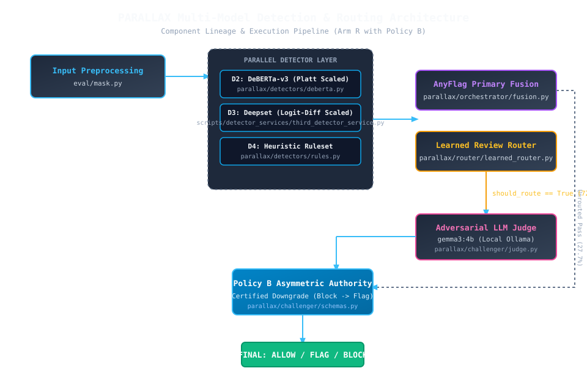
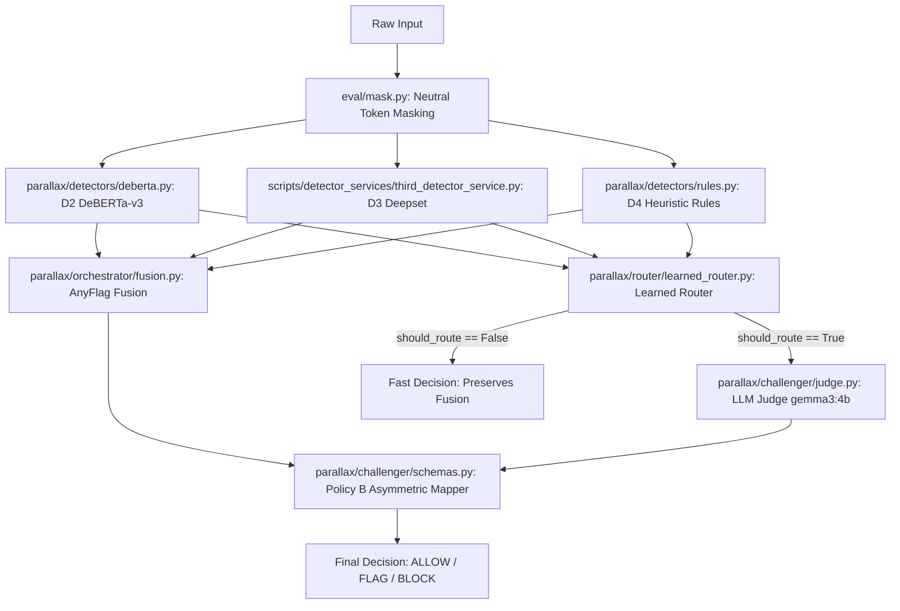

# PARALLAX End-to-End System Pipeline (Stage Architecture)

## 1. Architectural Flowchart

---

## 2. Component Lineage & Implementation Registry

| Pipeline Stage | Implementation File | Component Type & Provenance | Input Specification | Output Specification | Scientific Evidence & Ablation Status |
|---|---|---|---|---|---|
| **Input Token Masking** | [`eval/mask.py`](file:///C:/Users/harsh/Downloads/PARALLAX/eval/mask.py) | Rule-based regex / Normalizer | Raw untrusted prompt string | Masked prompt string (neutral token placeholders) | tests/test_eval_mask.py (prevents detector shortcut overfitting) |
| **D2 DeBERTa-v3 Detector** | [`parallax/detectors/deberta.py`](file:///C:/Users/harsh/Downloads/PARALLAX/parallax/detectors/deberta.py) | Pretrained Transformer + Platt scaling | Masked prompt string | Calibrated probability score in [0.0, 1.0] | tests/test_hf_detectors.py (Platt calibrator: val AUC 0.7500) |
| **D3 Deepset Injection Detector** | [`scripts/detector_services/third_detector_service.py`](file:///C:/Users/harsh/Downloads/PARALLAX/scripts/detector_services/third_detector_service.py) | Pretrained Transformer + Logit-Diff Platt scaling | Masked prompt string | Calibrated probability score in [0.0, 1.0] | tests/test_promptforest.py (saturation reduced from 95.0% to 16.2%) |
| **D4 Heuristic Rule Detector** | [`parallax/detectors/rules.py`](file:///C:/Users/harsh/Downloads/PARALLAX/parallax/detectors/rules.py) | Regex patterns / Obfuscation rules | Masked prompt string | Binary detection score in {0.0, 1.0} | tests/test_rules.py (100% precision on benign controls) |
| **Primary AnyFlag Fusion** | [`parallax/orchestrator/fusion.py`](file:///C:/Users/harsh/Downloads/PARALLAX/parallax/orchestrator/fusion.py) | Ensemble Composition Heuristic | Detector score vector [d2, d3, d4] | Preliminary decision {ALLOW, BLOCK}, confidence | tests/test_orchestrator.py (AnyFlag conservative boundary) |
| **Learned Review Router** | [`parallax/router/learned_router.py`](file:///C:/Users/harsh/Downloads/PARALLAX/parallax/router/learned_router.py) | Supervised Error Predictor (Logistic / LightGBM) | Feature vector [d2, d3, d4, discrepancy, confidence, enc, len] | should_route (bool), prob_error float | no ablation run (feature selection unablated; held-out AUC 0.432 vs label) |
| **Adversarial LLM Judge** | [`parallax/challenger/judge.py`](file:///C:/Users/harsh/Downloads/PARALLAX/parallax/challenger/judge.py) | Local 4B LLM (Ollama) | Masked prompt string + review system template | JudgeResult: verdict {ALLOW, BLOCK, ABSTAIN}, quote, reasoning | tests/test_challenger_judge.py (timeout extended to 60.0s) |
| **Authority Policy B Mapper** | [`parallax/challenger/schemas.py`](file:///C:/Users/harsh/Downloads/PARALLAX/parallax/challenger/schemas.py) | Asymmetric Decision Mapping Logic | Fusion decision + JudgeResult | Final decision {ALLOW, FLAG, BLOCK} | tests/test_challenger.py (blocks downgraded to FLAG only on certified allow) |

---

## 3. Evidence and Ablation Status Summary

- **Masking (`eval/mask.py`)**: Confirmed in `tests/test_eval_mask.py`. Strips synthetic marker shortcuts and normalizes industrial payloads.
- **D2 DeBERTa (`parallax/detectors/deberta.py`)**: Platt scaled on dev partition ($\sigma(1.4019 \cdot z - 0.3804)$). Evidence in `docs/DETECTOR_CALIBRATION.md`.
- **D3 Deepset (`scripts/detector_services/third_detector_service.py`)**: Logit-difference Platt scaled. Evidence in `docs/DETECTOR_CALIBRATION.md` (saturation reduced from 95.0% to 16.2%).
- **D4 Rules (`parallax/detectors/rules.py`)**: Heuristic patterns confirmed in `tests/test_rules.py`.
- **Primary Fusion (`parallax/orchestrator/fusion.py`)**: AnyFlag fusion combining calibrated detector outputs.
- **Learned Router (`parallax/router/learned_router.py`)**: Logistic regression on dev/val features. **Ablation status**: **no ablation run** (feature set chosen empirically without ablation). Held-out evaluation confirmed lack of error-prediction skill (AUC 0.53 vs fusion error) and routing asymmetry (AUC 0.435 vs label).
- **Adversarial Judge (`parallax/challenger/judge.py`)**: Ollama `gemma3:4b` arbiter with 60.0s client timeout cap.
- **Authority Policy B (`parallax/challenger/schemas.py`)**: Asymmetric decision mapper guaranteeing that certified blocks cannot be downgraded to ALLOW without review.
