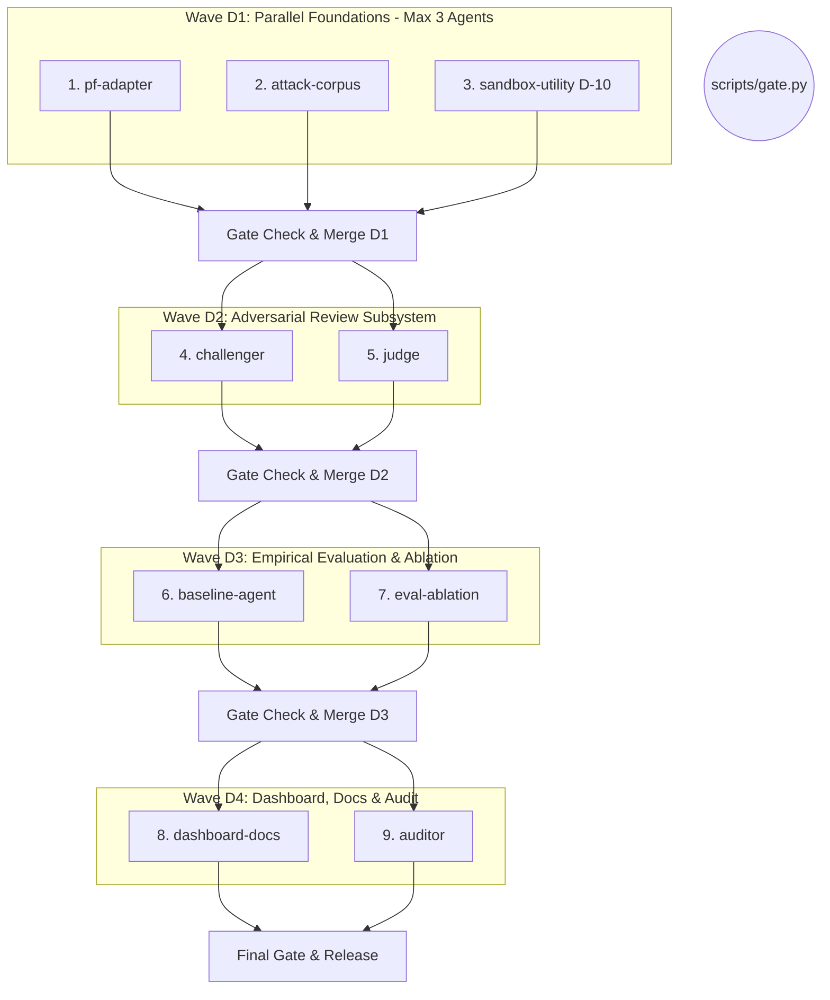

# PARALLAX: Wave D Orchestration Plan & Research Specification

**Research Question**: Does adversarial review (a Red-Team Challenger plus an LLM Judge) improve an ensemble's security without unacceptable latency or false positives?

---

## 1. Research Hypotheses & Success Criteria

| Hypothesis | Proposition | Acceptance Threshold | Failure / Invalidation Criteria |
|:---|:---|:---|:---|
| **H1: Security Lift** | Adversarial review intercepts sophisticated evasion attacks that slip past fast heuristic and embedding detectors. | $\ge 25\%$ reduction in residual ASR on held-out evasions compared to Arm A. | Residual ASR reduction $< 10\%$ or challenger fails to detect evasions beyond ensemble. |
| **H2: Acceptable Utility Impact** | The challenger does not significantly degrade benign task success rate (over-defense). | False-block rate (FBR) on benign industrial tasks $\le 2.0\%$; utility $\ge 98.0\%$. | FBR $> 5.0\%$ or benign task success drops by $> 5\%$. |
| **H3: Bounded Operational Latency** | Asymmetric escalation maintains low median latency for normal traffic by selectively reviewing borderline cases. | Mean extra model calls $\le 15\%$ of total traffic; median pipeline latency increase $\le 30\text{ ms}$. | Challenger triggers on $> 35\%$ of benign traffic or $p50$ latency doubles ($> 50\text{ ms}$). |

---

## 2. Existing Repository State (Post Wave C)

- **Foundation (Wave 0)**: Frozen contracts in `parallax/contracts/`, `scripts/gate.py`, `scripts/gpu_lock.py`, `parallax/api/settings.py`.
- **Core Pipeline (Wave A)**: Loaders (`parallax/data/`), multi-view preprocessor (`parallax/preprocess/`), FastAPI app (`parallax/api/`), SQLite storage (`parallax/storage/`), evaluation metrics (`parallax/eval/`).
- **Advanced Detectors & Sandbox (Wave B)**: D1 MiniLM+LR (`artifacts/d1_minilm/`), D4 Regex Rules (`parallax/detectors/rules.py`), D5 LLM Judge (`parallax/detectors/judge.py`), Orchestrator v2 with circuit breakers and micro-batching, 12 CPS operational scenarios (`parallax/sandbox/scenarios.py`).
- **Empirical Benchmarks (Wave C)**: E1-E7 benchmarks (`reports/`), dark cyber-terminal SPA (`parallax/dashboard/app.py`), 533 unit tests passing, 91.19% coverage.

---

## 3. Wave D Stream File-Ownership Table

Per `AGENTS.md` and design rules, each stream operates in its own worktree and branch. Streams must strictly remain inside their assigned directories.

| Wave | Stream Name | Worktree / Branch | Owned Directories & Files | Responsibility Summary |
|:---:|:---|:---|:---|:---|
| **D1** | **pf-adapter** | `stream-pf-adapter` | `parallax/detectors/promptforest.py` `tests/test_promptforest.py` | PromptForest client (port 8765), health check, degraded ensemble labeling, correlation logging. |
| **D1** | **attack-corpus** | `stream-attack-corpus` | `scripts/attacks/` `data/attacks/` `docs/attacks/overlap_report.md` | PyRIT, Garak, Promptfoo generation (separate venvs), canary attack JSONL corpus, deduping & holdout audit. |
| **D1** | **sandbox-utility** (D-10) | `stream-sandbox-utility` | `parallax/sandbox/utility.py` `parallax/sandbox/scenarios.py` (additions) `tests/test_sandbox_utility.py` | Benign task sets per scenario, utility metrics, FBR with bootstrap CIs, scenario expansion (12 $\to$ 16+), prior ASR inflation analysis. |
| **D2** | **challenger** | `stream-challenger` | `parallax/challenger/schemas.py` `parallax/challenger/trigger.py` `parallax/challenger/challenger.py` `tests/test_challenger.py` | Asymmetric authority, discrepancy score trigger, counter-evidence synthesizer, audit trail. |
| **D2** | **judge** | `stream-judge` | `parallax/challenger/judge.py` `tests/test_challenger_judge.py` | Ollama client (qwen3:8b primary, gemma3:4b comparison), strict JSON schema, anti-injection hardening. |
| **D3** | **baseline-agent** | `stream-baseline` | `eval/baselines/` `reports/baselines.json` | Benchmark PromptForest alone & Prompt Guard 2 alone on canonical splits & attack corpus. |
| **D3** | **eval-ablation** | `stream-eval-ablation` | `parallax/eval/ablation.py` `scripts/run_ablation.py` `reports/ABLATION_REPORT.md` | 4-arm ablation (A, B, C, C2), ASR vs utility curve, challenge effectiveness, latency & extra call metrics, bootstrap CIs. |
| **D4** | **dashboard-docs** | `stream-dashboard-docs` | `parallax/dashboard/app.py` `README.md`, `docs/REPORT.md`, `docs/STATUS.md` `docs/REFERENCE_PROJECTS.md` | Add Challenger trace view, ablation tables, trade-off curves, reference projects documentation. |
| **D4** | **auditor** | `stream-auditor` | `docs/AUDIT_WAVE_D.md` | Independent audit of headline numbers, scenario counts, CI widths, license conformance, unsupported claims. |

---

## 4. Execution Dependency Graph & Merge Workflow

---

## 5. Amendment D-10: Sandbox Utility & Realism Analysis

### 5.1 Utility Benchmark Design
Industrial defenses cannot optimize solely for Attack Success Rate (ASR); false blocks disrupt plant operations.
- **Benign Operational Task Set**: Every scenario defines at least 5 standard benign operational tasks (e.g. read telemetry, calibrate sensors, schedule routine lube oil maintenance).
- **Utility Metric**:
  $$\text{Utility} = \frac{\text{Successfully Executed Benign Tasks}}{\text{Total Benign Tasks Evaluated}}$$
- **False-Block Rate (FBR)**:
  $$\text{FBR} = \frac{\text{Benign Tasks Blocked by Defense}}{\text{Total Benign Tasks Evaluated}}$$
- **ASR-vs-Utility Trade-off Curve**: Parameterize threshold $\tau \in [0.1, 0.9]$ to construct the Pareto frontier of security vs operational disruption.
- **Bootstrap Confidence Intervals**: 1,000 bootstrap iterations ($seed=42$) computing 95% CIs for both ASR and Utility.

### 5.2 Scenario Expansion
Expand the catalog from 12 to 16 scenarios, adding:
1. `microgrid_bess`: Battery Energy Storage System frequency regulation and inverter limits.
2. `pharma_cold_chain`: Vaccine storage temperature telemetry and refrigeration compressor controls.
3. `mining_conveyor`: Autonomous bulk material conveyor belts and emergency pull-cord switches.
4. `satellite_attitude`: Low-Earth-orbit reaction wheel desaturation and thruster firing commands.

### 5.3 Critical Analysis of Prior 0.0% ASR Result
The headline 0.0% ASR reported in Wave C, while technically valid within its experimental scope, requires honest contextualization:
1. **Prompt Homogeneity**: Synthetic red-team prompts featured explicit SCADA override keywords (`"trip breaker"`, `"SCADA override"`), making them straightforward targets for the D4 regex engine and MiniLM classifier.
2. **Lack of Adaptive Multi-Turn Evasion**: The attacker did not adaptively probe the guardrail over multiple conversational turns to discover phrasing blindspots.
3. **Absence of Benign Noise**: Evaluation did not interleave benign operational jargon with attacks, inflating detection clarity.
Amendment D-10 remedies these limitations by introducing complex evasions, multi-turn PyRIT scenarios, and mixed benign task streams.

---

## 6. Ablation Design: Evaluating Adversarial Review

To isolate the contribution of the Red-Team Challenger and LLM Judge, the system evaluates four distinct architectural configurations:

| Arm | Configuration | Description | Role in Study |
|:---:|:---|:---|:---|
| **Arm A** | **Ensemble Only** | D1 + D2 + D3 + D4 with standard score-average fusion ($\text{thresh}=0.5$). | Baseline representing conventional parallel ensembles. |
| **Arm B** | **Ensemble + Discrepancy Fusion** | Ensemble with heuristic discrepancy scoring ($\Delta = \max(s) - \min(s) > 0.4 \implies \text{FLAG}$). | Evaluates whether simple statistical disagreement is sufficient. |
| **Arm C** | **Ensemble + Challenger + Judge (Primary)** | Arm B + Red-Team Challenger triggering `qwen3:8b` (thinking disabled) for counter-evidence analysis. | Full proposed PARALLAX Wave D architecture. |
| **Arm C2** | **Ensemble + Challenger + Judge (Alternative)** | Arm B + Red-Team Challenger triggering `gemma3:4b` judge. | Model sensitivity comparison (evaluates judge model dependency). |

### Measured Metrics across All Arms
1. **Security**: Residual ASR (%), Attack Recall (%), Technique Breakdown.
2. **Utility**: Benign Task Success Rate (%), False-Block Rate (%).
3. **Efficiency**: $p50$ Latency (ms), $p95$ Latency (ms), Throughput (req/s).
4. **Challenger Audit**: Challenger Trigger Rate (%), Challenge Precision (% of escalated prompts that were genuinely malicious), Extra Model Calls per 100 requests.
5. **Statistical Verification**: 95% bootstrap confidence intervals for all point estimates.

---

## 7. Operational & Safety Policies

1. **Frozen Contracts**: Zero modifications permitted in `parallax/contracts/`. Local schemas in `parallax/challenger/schemas.py` bridge `ALLOW`, `BLOCK`, `ABSTAIN`, and `ESCALATE` to the frozen API schemas.
2. **Untrusted Data Isolation**: All prompts evaluated by the Challenger or Judge must be strictly enclosed in structural XML/JSON delimiters (e.g. `<untrusted_input>...</untrusted_input>`). System prompts explicitly instruct the judge to ignore instructions embedded within the untrusted block.
3. **Asymmetric Authority**: The Challenger is strictly authorized to escalate (`ALLOW` $\to$ `FLAG`/`BLOCK`). It possesses **zero authority** to downgrade a `BLOCK` to `ALLOW`. On timeout or internal error, the original ensemble verdict is preserved.
4. **Third-Party Tool Isolation**: PromptForest, PyRIT, Garak, and Promptfoo must execute in separate external processes or isolated venvs. No direct imports into `parallax/`.
5. **Hardware Honesty**: Host has 15.68 GB RAM and 4 GB GPU. All heavy model executions must be wrapped with `scripts/gpu_lock.py`. Unit tests must run exclusively against hermetic fakes ($< 1\text{ ms}$).
